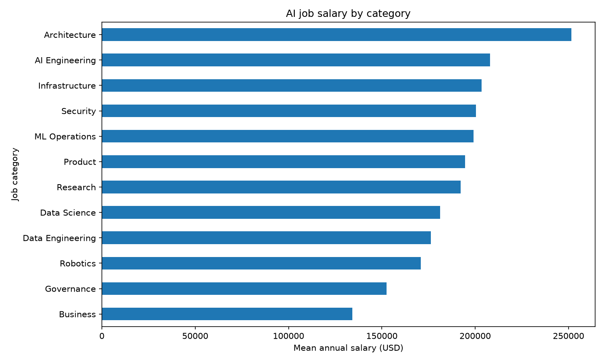

# AI Jobs Pipeline — Week 11 Mini-Assignment

This repository began as the class AutoML Research Lab. For Part 1 of my Week 11 assignment, I added an Airflow pipeline that combines AI job postings from my earlier project with country data from the World Bank. The class fraud example is still in the repository. Part 2 uses the output of the new DAG to train and compare salary models.

## What the pipeline does

The two independent sources are the [AI Jobs Market 2025–2026 Kaggle dataset](https://www.kaggle.com/datasets/alitaqishah/ai-jobs-market-2025-2026-salaries), which I used in my earlier project and saved here as [`ai_jobs_market_2025_2026.csv`](datasets/ai_jobs/ai_jobs_market_2025_2026.csv) (1,500 postings), and a [World Bank GDP per capita](https://data.worldbank.org/indicator/NY.GDP.PCAP.CD) snapshot for 2024, saved as [`world_bank_gdp_per_capita_2024.csv`](datasets/ai_jobs/world_bank_gdp_per_capita_2024.csv). Airflow also splits the postings' skill lists into a job-skill table. It cleans jobs, skills, and country data in parallel, then joins skill counts and GDP per capita by country. The four resulting tables are loaded into PostgreSQL. The final task reads the joined table back from PostgreSQL to make the salary chart and exports `datasets/ai_jobs/ai_jobs_clean_latest.csv` for Part 2. Global postings have no country match and keep a null GDP value.

The DAG, `ai_jobs_salary_pipeline`, is scheduled for Mondays at 09:00 UTC. It uses Airflow's `LocalExecutor`, and only one DAG run can load the tables at a time. See [the Part 1 notes](docs/AI_JOBS_PART1.md) for the cleaning rules and task graph.

## Run Part 1

Start Docker Desktop, create `.env` from `.env.example` if needed, then run these commands from the repository root:

```bash
docker compose -f infra/docker-compose.yml --env-file .env --profile airflow up --build -d airflow-db airflow-init airflow-scheduler airflow-webserver
docker compose -f infra/docker-compose.yml --env-file .env --profile airflow exec airflow-scheduler airflow dags unpause ai_jobs_salary_pipeline
docker compose -f infra/docker-compose.yml --env-file .env --profile airflow exec airflow-scheduler airflow dags trigger ai_jobs_salary_pipeline
docker compose -f infra/docker-compose.yml --env-file .env --profile airflow exec airflow-scheduler airflow dags list-runs -d ai_jobs_salary_pipeline
```

Airflow is at <http://localhost:8088>. The default login is `admin` / `admin`, unless `.env` overrides it. The per-run chart, CSV summaries, and JSON report are written under `artifacts/airflow/ai_jobs/`.

## What I found

I ran the revised DAG twice successfully on November 5, 2026, after two successful runs of the earlier version. After the second revised run, PostgreSQL contained 1,500 jobs, 9,428 distinct job-skill pairs, 13 country observations, and 1,500 joined rows, with no duplicates from the rerun. Country data matched 1,418 postings; the other 82 were labeled Global. Across the postings, mean annual salary was $194,892. Architecture had the highest category mean at $251,576.92. This is a descriptive comparison of the supplied records, not an estimate of what a job category causes someone to earn.



Airflow evidence: [successful Grid run](docs/images/ai_jobs_airflow_grid.png) · [DAG Graph](docs/images/ai_jobs_airflow_graph.png).

## Part 2: agent-based salary modeling

I built a separate LangGraph workflow for salary regression in [`ai_jobs_loop/graph.py`](ai_jobs_loop/graph.py), using the class exercise as a template for the node pattern. The Data Auditor checks the CSV exported by Part 1. The Experiment Planner chooses a regressor, the Model Trainer measures validation error, and the Evaluation Judge either loops back for another trial or sends the best model to the Holdout Reporter. The live graph and metrics are at `/ai-jobs-loop`; the original classroom build loop remains available at `/student-loop`.

Run Part 1 first so `datasets/ai_jobs/ai_jobs_clean_latest.csv` exists. Then start the web app with `make start-mac` (or `make start-windows` from Git Bash) and open <http://127.0.0.1:5173/ai-jobs-loop>. Click **Run agent loop**. No API key is needed. The planner starts with Ridge, then compares its validation MAE with a mean-prediction baseline. An improvement below 10% sends the next trial to Random Forest; otherwise it tries Extra Trees. The judge stops when the target MAE is met or the trial budget is used. The page shows each decision in Agent activity. To let OpenRouter choose among untried models instead, set `AI_JOBS_USE_LLM=true` and `OPENROUTER_API_KEY` in `.env`, then restart the gateway.

The model uses the joined GDP per capita value alongside job fields; IDs and salary-derived fields are excluded. I used a fixed 60% training / 20% validation / 20% holdout split with seed 42. Only validation MAE selects the model; the holdout is used once at the end. With three trials, Ridge had the lowest validation MAE ($44,479.50). Its holdout MAE was $43,857.32 and holdout R² was 0.2681, compared with $53,456.47 MAE for a mean-prediction baseline. The improvement is useful for prediction on this split, although the modest R² leaves substantial salary variation unexplained.

Evidence: [live agent graph](docs/images/ai_jobs_agent_graph.png) · [model evaluation results](docs/images/ai_jobs_model_results.png).

## Original class demo

The setup notes below describe the instructor's fraud-data and simple-loop examples. They are kept here as reference for Part 2.

Classroom demo in two parts:

1. **Airflow** — merge CSVs, train a baseline, publish a dataset (Docker only)
2. **LangGraph simple loop** — run the mini research loop in the UI (no Airflow required)

You can run the sections independently, or run Airflow first so `/simple-loop` can use `merged_latest.csv`.

---

## Prerequisites

| Tool | macOS | Windows |
| --- | --- | --- |
| Docker Desktop | Install from [docker.com](https://www.docker.com/products/docker-desktop/); leave it running | Same; use the WSL2 backend (recommended) |
| Python 3.12+ | Homebrew / python.org | python.org installer; check **Add python.exe to PATH** |
| Node.js 20+ | Homebrew / nodejs.org | nodejs.org LTS installer |
| Make | Xcode CLT (`xcode-select --install`) or Homebrew | [Git for Windows](https://git-scm.com/download/win) (Git Bash includes `make`) or `choco install make` |
| Git | Xcode CLT / Homebrew | [Git for Windows](https://git-scm.com/download/win) |
| Terminal | Terminal.app / iTerm | **Git Bash** for `make start-windows` / `make down-windows` |

Do not install Airflow on the host. It runs only in Docker.

---

## One-time: clone and env

```bash
git clone https://github.com/yihanc09/IDS706-Orchestration.git
cd IDS706-Orchestration
```

```bash
cp .env.example .env          # macOS / Git Bash
# Copy-Item .env.example .env # Windows PowerShell
```

`make start-mac` / `make start-windows` / `make airflow` will create `.env` from `.env.example` if it is missing.

Edit `.env` as needed:

| Variable | Used by | Required? |
| --- | --- | --- |
| `OPENROUTER_API_KEY` | Simple loop LLM agents | Recommended (without it, nodes use fallbacks) |
| `OPENROUTER_MODEL` | Simple loop | Optional (default: `nvidia/nemotron-3.5-lightning:free`) |
| `AI_JOBS_USE_LLM` | AI jobs experiment planner | Optional (default: `false`) |
| `AIRFLOW_ADMIN_USER` / `AIRFLOW_ADMIN_PASSWORD` | Airflow UI | Optional (default: `admin` / `admin`) |
| `CURSOR_API_KEY` | Simple/student loop when Model = Cursor SDK; also full multi-agent stack | Optional |
| `WANDB_*` | Full multi-agent stack only | Optional |

Keep secrets in `.env`. Never commit real keys.

---

## Quick start — web app (one command)

Docker Desktop must be running. From the **repo root**, pick your OS:

| | macOS | Windows |
| --- | --- | --- |
| **Start** (Docker + UI) | `make start-mac` | `make start-windows` *(Git Bash)* |
| **Stop** (Vite + Docker) | `make down-mac` | `make down-windows` *(Git Bash)* |

```bash
# macOS
make start-mac
make down-mac

# Windows (Git Bash)
make start-windows
make down-windows
```

`make start` / `make down` alone print this reminder and exit — always use the `-mac` or `-windows` target.

That will:

1. Ensure `.env` exists
2. Build/start the Docker stack (gateway + services)
3. Wait until `http://127.0.0.1:8000/healthz` is up
4. `npm install` + start Vite

Then open **[http://127.0.0.1:5173](http://127.0.0.1:5173)**

Useful routes once the UI is up:

| Route | What |
| --- | --- |
| [/guide](http://127.0.0.1:5173/guide) | Student guide (Airflow + LangGraph copyable steps) |
| [/simple-loop](http://127.0.0.1:5173/simple-loop) | Instructor mini-loop |
| [/student-loop](http://127.0.0.1:5173/student-loop) | Student Build Loop lab |

`down-mac` frees `:5173` with `lsof`. `down-windows` frees `:5173` with PowerShell, then both run `docker compose … down`.

---

## Section 1: Set up Airflow

Goal: start Airflow in Docker, confirm the UI + DAGs, run prep, publish a subset CSV for later use.

### Steps (macOS / Make)

1. Make sure **Docker Desktop** is running.
2. From the **repo root**, ensure `.env` exists (`cp .env.example .env` if needed).
3. Start the Airflow profile:

```bash
make airflow
```

Equivalent:

```bash
docker compose -f infra/docker-compose.yml --env-file .env --profile airflow up --build -d
```

4. **Wait 1–2 minutes** (longer on first build). Confirm containers:

```bash
docker compose -f infra/docker-compose.yml --env-file .env --profile airflow ps
```

`airflow-webserver` should be healthy / running before you open the UI.

5. Open [http://localhost:8088](http://localhost:8088) and log in with `admin` / `admin` (unless `.env` overrides).
6. Confirm the DAG list has:
   - `student_baseline_prep` — student lab (empty Graph until wired)
   - `simple_loop_baseline_prep` — instructor / filled reference
   - `simple_loop_baseline_and_trigger` — later reveal (stub)

Docker only. Do not install Airflow on your host.

**Run prep (UI):** unpause `simple_loop_baseline_prep` → Trigger → Graph tab (tasks turn green).


**CLI alternative (still Docker):**

```bash
docker compose -f infra/docker-compose.yml --env-file .env --profile airflow run --rm airflow-prep-once
```

**Confirm publish**

```bash
ls -la datasets/airflow/merged_latest.csv
ls -la artifacts/airflow/runs/
```

**Stop Airflow** (also stops the main stack + Vite if it was up):

```bash
make down-mac          # macOS
# make down-windows    # Windows (Git Bash)
```

### Windows — Airflow

```powershell
if (-not (Test-Path .env)) { Copy-Item .env.example .env }
docker compose -f infra/docker-compose.yml --env-file .env --profile airflow up --build -d
```

Wait 1–2 minutes, then:

```powershell
docker compose -f infra/docker-compose.yml --env-file .env --profile airflow ps
```

**UI:** [http://localhost:8088](http://localhost:8088) — `admin` / `admin`  
Same DAGs as above.

**Run prep (UI):** unpause `simple_loop_baseline_prep` → Trigger → Graph.

**CLI alternative:**

```powershell
docker compose -f infra/docker-compose.yml --env-file .env --profile airflow run --rm airflow-prep-once
```

**Confirm publish**

```powershell
Get-Item datasets\airflow\merged_latest.csv
Get-ChildItem artifacts\airflow\runs\
```

**Stop**

```powershell
docker compose -f infra/docker-compose.yml --env-file .env --profile airflow down
```

What the prep DAG does:

`customers.csv` ⨝ `transactions.csv` → subset (~2000 rows) → train baseline → publish

More detail: [`airflow/README.md`](airflow/README.md) · data: [`datasets/airflow/ATTRIBUTION.md`](datasets/airflow/ATTRIBUTION.md)

---

## Section 2: LangGraph simple loop

Goal: run the mini LangGraph loop at `/simple-loop`.

**macOS:** `make start-mac` (see Quick start) is enough — backend + UI.  
**Windows:** `make start-windows` from Git Bash.

Then open [http://127.0.0.1:5173/simple-loop](http://127.0.0.1:5173/simple-loop)

- After Section 1: dataset `merged_latest.csv`, target `is_fraud`
- Without Airflow: e.g. `Titanic-Dataset.csv`, target `Survived`


**Optional checks**

```bash
make health
curl -s http://127.0.0.1:8000/simple-loop/info | python3 -m json.tool
```

**Backend only** (no Vite): `make up` then `make health`  
**Frontend only** (stack already up): `make frontend`

**Stop:** `make down-mac` or `make down-windows` (Vite + Docker).

**CLI only (optional)** — needs local install once: `make install`

```bash
.venv/bin/python mini_loop/run_cli.py \
  --dataset datasets/Titanic-Dataset.csv \
  --target Survived \
  --max-cycles 3
```

### Windows — simple loop

`make start-windows` from Git Bash (see Quick start), then open `/simple-loop`.

```powershell
foreach ($port in 8000,8011,8002,8003,8004,8005,8006) {
  Write-Host -NoNewline "localhost:$port -> "
  try {
    Invoke-RestMethod "http://127.0.0.1:$port/healthz" | Out-Null
    Write-Host "ok"
  } catch {
    Write-Host "FAIL"
  }
}
```

**Stop**

```powershell
docker compose -f infra/docker-compose.yml --env-file .env down
```

**CLI only (optional)**

```powershell
python -m venv .venv
.\.venv\Scripts\pip install -e ".[dev]"
.\.venv\Scripts\python mini_loop\run_cli.py `
  --dataset datasets\Titanic-Dataset.csv `
  --target Survived `
  --max-cycles 3
```

---

## Suggested classroom order

| Order | What | Outcome |
| --- | --- | --- |
| 1 | Airflow **student** DAG `student_baseline_prep` | Fill [`airflow/dags/student_baseline_prep.py`](airflow/dags/student_baseline_prep.py), wire deps → Graph fills → run |
| 2 | (Optional reveal) instructor DAG | Baseline + `merged_latest.csv` via `simple_loop_baseline_prep` |
| 3 | LangGraph **Build Loop** | Fill [`student_loop/graph.py`](student_loop/graph.py) → `/student-loop` empty until ready → Run |
| 4 | (Optional reveal) `/simple-loop` | Instructor mini-loop on the same CSV |
| 5 | (Later) `simple_loop_baseline_and_trigger` | Reveal how Airflow could call the loop |

Guide UI: [http://127.0.0.1:5173/guide](http://127.0.0.1:5173/guide) after `make start-mac` / `make start-windows`.

### Build Loop (student LangGraph)

With the web app running:

1. Follow [`student_loop/COPY_GUIDE.md`](student_loop/COPY_GUIDE.md) — paste into [`student_loop/graph.py`](student_loop/graph.py) one step at a time
2. Open [http://127.0.0.1:5173/student-loop](http://127.0.0.1:5173/student-loop)
3. **Refresh graph**, then **Run loop**

**macOS status check:** `python -m student_loop.run_cli --status` (after `make install`)  
**Windows status check:** `.\.venv\Scripts\python -m student_loop.run_cli --status`

### Airflow student DAG

After Airflow is up, open the UI and find `student_baseline_prep`. The Graph tab stays empty until the wiring block in [`airflow/dags/student_baseline_prep.py`](airflow/dags/student_baseline_prep.py) is uncommented. Copy steps: [`airflow/dags/COPY_GUIDE.md`](airflow/dags/COPY_GUIDE.md) or the in-app guide.

---

## Useful ports

| What | URL |
| --- | --- |
| Frontend | http://127.0.0.1:5173 |
| Gateway API | http://127.0.0.1:8000 |
| Airflow UI | http://localhost:8088 |
| MLflow (full stack) | http://127.0.0.1:5050 |

## Make targets

| Target | OS | What |
| --- | --- | --- |
| `make start-mac` | macOS | Ensure `.env`, Docker stack, wait for gateway, Vite UI |
| `make start-windows` | Windows (Git Bash) | Same as `start-mac` |
| `make down-mac` | macOS | Stop Vite (`lsof` :5173) + Docker (incl. Airflow) |
| `make down-windows` | Windows (Git Bash) | Stop Vite (PowerShell :5173) + Docker (incl. Airflow) |
| `make airflow` | both | Start Airflow profile (UI on :8088) |
| `make up` | both | Docker stack only |
| `make health` | both | Curl service `/healthz` ports |
| `make frontend` | both | Vite only (stack already up) |
| `make install` | both | Local `.venv` + editable install (CLI / tests) |

---

## Full multi-agent lab (not required for the two demos above)

### macOS

```bash
cp .env.example .env   # set MOCK_*=false for live research
make start-mac
```

### Windows (Git Bash)

```bash
cp .env.example .env   # then edit MOCK_*=false for live research
make start-windows
```

Upload `datasets/churn_sample.csv`, target `churned`.  
Design canvas: [`AutoML_Research_Lab_demo_canvas.pdf`](AutoML_Research_Lab_demo_canvas.pdf) · mock script: [`docs/DEMO_SCRIPT.md`](docs/DEMO_SCRIPT.md)
