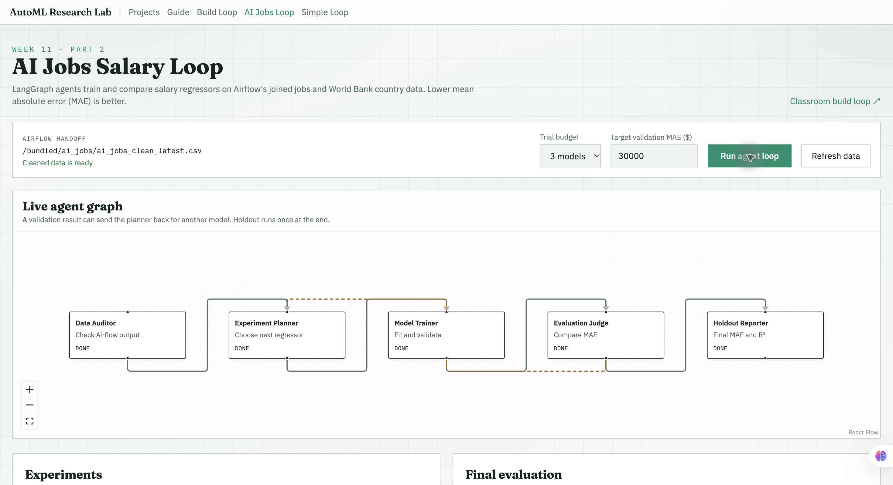
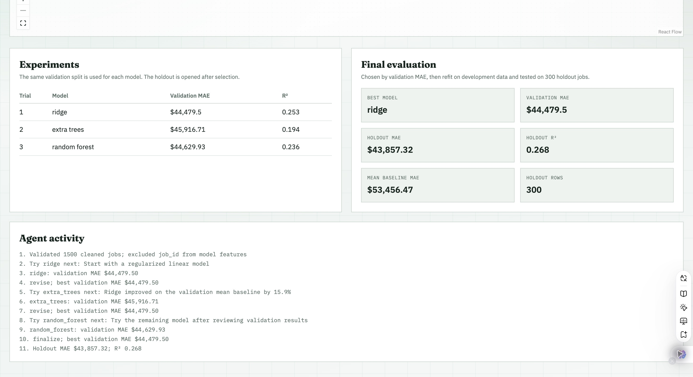
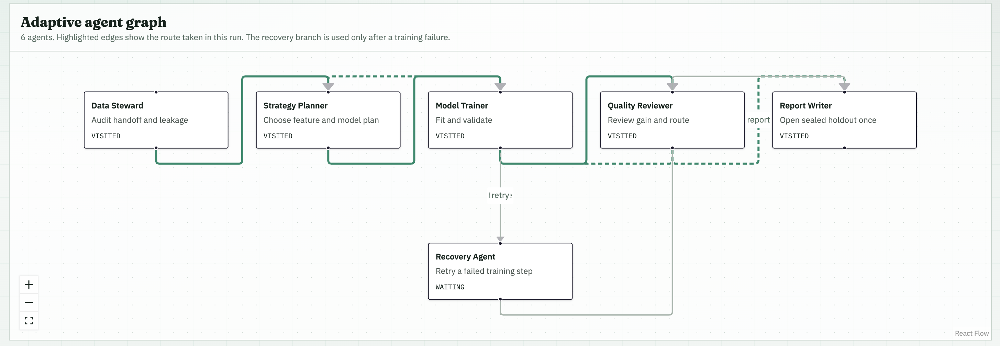

# AI Jobs Salary Pipeline — Week 11

I built this project for the Week 11 assignment, starting from the class AutoML Research Lab repository. I used the AI jobs data from my earlier project and added a separate World Bank country dataset. Part 1 prepares the data in Airflow. Part 2 uses that cleaned output in a salary prediction loop. For the optional bonus, I built a separate multi-agent workflow around a hiring analytics question: **what salary budget should a team consider for a new AI role?**

The classroom demo routes are still available as references, but the AI jobs DAG, salary model loop, and bonus graph have their own code and live pages.

| Assignment part | Code | Evidence |
| --- | --- | --- |
| Part 1: scheduled pipeline | [Airflow DAG](airflow/dags/ai_jobs_pipeline.py) | [Successful Grid run](docs/images/ai_jobs_airflow_grid.png), [DAG Graph](docs/images/ai_jobs_airflow_graph.png) |
| Part 2: model loop | [Salary agent graph](ai_jobs_loop/graph.py) | [Live graph](docs/images/ai_jobs_agent_graph.png), [model results](docs/images/ai_jobs_model_results.png) |
| Part 3: adaptive bonus | [Budget agent graph](salary_budget_agents/graph.py), [evaluation suite](salary_budget_agents/evaluate.py) | [Normal graph](docs/images/salary_budget_graph.png), [recovery graph](docs/images/salary_budget_recovery_graph.png), [evaluation](docs/images/salary_budget_evaluation.png) |

## Setup

I ran the project with Docker Compose and the included service images ([Airflow Dockerfile](infra/Dockerfile.airflow), [service Dockerfile](infra/Dockerfile.service)). Docker Desktop, Docker Compose, Node.js, and npm are needed for the same local setup. From the repository root:

~~~bash
cp .env.example .env
~~~

The default runs below do not need an LLM API key. The two source CSVs are committed, so the DAG does not download data during execution. The local .env file and generated runtime files are ignored by Git.

## Part 1 — Airflow data pipeline

### Sources and transformations

I used two independently published sources. The [AI Jobs Market 2025–2026 dataset on Kaggle](https://www.kaggle.com/datasets/alitaqishah/ai-jobs-market-2025-2026-salaries) supplies 1,500 job postings, including salary, category, experience, work arrangement, country, and skills. I downloaded 2024 [World Bank GDP per capita](https://data.worldbank.org/indicator/NY.GDP.PCAP.CD) observations for the 13 countries named in those postings and saved that snapshot separately. The files are [AI jobs postings](datasets/ai_jobs/ai_jobs_market_2025_2026.csv) and [2024 GDP per capita](datasets/ai_jobs/world_bank_gdp_per_capita_2024.csv).

The DAG inspects each source, then cleans three related tables:

| Clean table | Transformation |
| --- | --- |
| ai_jobs.jobs | Trim text, convert numeric values, remove invalid required values and duplicate job IDs. |
| ai_jobs.job_skills | Split each posting's skill list into one row per job and skill, normalize text, remove duplicate pairs. |
| ai_jobs.country_context | Keep valid 2024 observations with positive GDP per capita and one row per ISO3 country code. |

I aggregated skill counts and a Python-skill flag back to each job, then left-joined the country data by ISO3 code. The result, ai_jobs.jobs_enriched, has one row per job. The 82 postings labeled Global remain in the table with missing GDP because they do not name a country. The load replaces all four tables inside one PostgreSQL transaction, so a rerun does not append duplicate records. The pipeline reads jobs_enriched **back from PostgreSQL** to create the analysis chart and publish the cleaned CSV for Parts 2 and 3.

### Schedule and task graph

The DAG ID is ai_jobs_salary_pipeline. It is scheduled for **Monday at 09:00 UTC**, with catchup disabled and one active run at a time. LocalExecutor can run the two source inspections independently, and the jobs, skills, and country cleaning tasks can run in parallel. The merge waits for all three cleaned inputs; database load and analysis follow in order.

~~~text
inspect_jobs_source ─┬─> clean_jobs ───────────┐
                     └─> clean_skills ─────────┤
inspect_gdp_source ─────> clean_country_context ┴─> merge_tables ─> load_postgres ─> analyze_from_database
~~~

### Run and check Part 1

~~~bash
docker compose -f infra/docker-compose.yml --env-file .env --profile airflow up --build -d airflow-db airflow-init airflow-scheduler airflow-webserver
docker compose -f infra/docker-compose.yml --env-file .env --profile airflow exec airflow-scheduler airflow dags unpause ai_jobs_salary_pipeline
docker compose -f infra/docker-compose.yml --env-file .env --profile airflow exec airflow-scheduler airflow dags trigger ai_jobs_salary_pipeline
docker compose -f infra/docker-compose.yml --env-file .env --profile airflow exec airflow-scheduler airflow dags list-runs -d ai_jobs_salary_pipeline
~~~

The Airflow UI is at <http://localhost:8088> (default login: admin / admin). The [Grid screenshot](docs/images/ai_jobs_airflow_grid.png) shows successful runs and all eight tasks. The [Graph screenshot](docs/images/ai_jobs_airflow_graph.png) shows both source branches and the parallel cleaning work. To inspect the loaded table:

~~~bash
docker compose -f infra/docker-compose.yml --env-file .env --profile airflow exec airflow-db psql -U airflow -d airflow -c 'SELECT COUNT(*) FROM ai_jobs.jobs_enriched;'
~~~

My local run left **1,500 enriched jobs**, **9,428 distinct job-skill pairs**, and **13 country observations** in PostgreSQL. GDP matched 1,418 jobs; the remaining 82 were Global postings. The database-backed analysis found a mean annual salary of **$194,892**. Architecture had the highest category mean at **$251,576.92**. The chart and JSON report are generated under artifacts/airflow/ai_jobs/<run-key>/.

These salary figures describe this dataset; they do not establish that a category or GDP causes a particular salary. [Part 1 methods and run checks](docs/AI_JOBS_PART1.md) give the cleaning rules and output paths in more detail.

## Part 2 — agent-based salary model loop

I adapted the class exercise's agent pattern to a regression task, with a graph implemented in [ai_jobs_loop/graph.py](ai_jobs_loop/graph.py). The **Data Auditor** checks the Airflow handoff and excludes IDs and salary-derived fields. The **Experiment Planner** chooses a regressor, the **Model Trainer** fits and validates it, and the **Evaluation Judge** either sends the planner back for another trial or selects the best result. The **Holdout Reporter** refits the selected model and evaluates the holdout once. This conditional loop is implemented in the salary workflow; the page renders its graph and agent states.

I used seed 42 and a 60% training / 20% validation / 20% holdout split. Candidate models use the same split, so their validation MAE values are comparable. The holdout is reserved until after selection. With three trials, **Ridge** had the best validation MAE at **$44,479.50**. Its holdout MAE was **$43,857.32**, with **R² = 0.2681**. A mean-prediction baseline had **$53,456.47** holdout MAE. The modest R² means these posting fields leave much salary variation unexplained.

After Part 1 finishes, start the web app from the repository root with make start-mac (or make start-windows in Git Bash). Open <http://127.0.0.1:5173/ai-jobs-loop>, select three models, and click **Run agent loop**. The page shows the live graph, trial metrics, final evaluation, and agent activity.

## Part 3 — adaptive salary budget workflow (bonus)

For the bonus, I treated the model output as a hiring analytics **budget reference**, not an automatic pay decision. A recruiter or analyst enters the new role's category, years of experience, location, remote arrangement, and LLM/Python requirements. The workflow returns a salary estimate with measured error, a baseline comparison, assumptions, and a limitation note.

I implemented this as a **separate graph** in [salary_budget_agents/graph.py](salary_budget_agents/graph.py). It does not call the Part 2 loop. Its six agents have distinct jobs:

1. **Data Steward** checks the cleaned data, requested role, and missing country context.
2. **Strategy Planner** chooses the next model and whether GDP is usable as a feature.
3. **Model Trainer** fits the selected pipeline and returns validation MAE and R².
4. **Quality Reviewer** compares validation MAE with a category-mean baseline and decides whether another trial is worth using.
5. **Recovery Agent** handles a trainer failure and permits one retry.
6. **Report Writer** opens the sealed holdout once after selection and writes the role brief.

The graph routes based on intermediate results. If GDP missingness exceeds 20%, the planner uses job-only features. The reviewer stops when the validation gain reaches the target or the trial budget is spent; otherwise it loops back to the planner. A failed trainer step goes through the Recovery Agent, which retries once and then ends that failed route if it still fails. The dashboard's **Simulate one trainer failure** option makes this branch visible without relying on an external outage. The default trial budget is three and the target gain is 20% over the development-set category baseline.

Run make start-mac or make start-windows, then open <http://127.0.0.1:5173/salary-budget>. Enter a role and click **Run workflow**. I also ran the simulated failure path; its [graph](docs/images/salary_budget_recovery_graph.png) shows Recovery Agent visited, and its [decision trace](docs/images/salary_budget_recovery_trace.png) shows the retry and completed report.

For the default AI Engineering role (five years, fully remote, USA, LLM and Python), the brief estimates **$212,087.06** annually. The selected model's holdout MAE is **$43,857.32** and R² is **0.2681**. The [brief screenshot](docs/images/salary_budget_brief.png) shows the role estimate beside the validation trials.

### Evaluation and baselines

The suite in [salary_budget_agents/evaluate.py](salary_budget_agents/evaluate.py) tests normal execution, missing GDP, salary-proxy leakage, a temporary trainer failure, and an exhausted trial budget. Each case declares its input, expected behavior, scoring checks, and a **1.00 pass threshold**; it checks intermediate decisions, final output quality, and agent coordination. All **5/5 cases passed** locally. Run it from the repository root after starting the app stack:

~~~bash
docker compose -f infra/docker-compose.yml --env-file .env exec gateway env PYTHONPATH=/:/app python -m salary_budget_agents.evaluate
~~~

The CLI writes artifacts/salary_budget/evaluation.json. The dashboard also has a **Run evaluation suite** button. For the same 300-row salary holdout, I compared the bonus graph with two references:

| Workflow | Holdout MAE | Holdout R² | Comparison |
| --- | ---: | ---: | --- |
| Fixed-step Airflow-style category-mean baseline | $51,735.16 | 0.0718 | Fixed salary-by-category analysis fitted on development data only. |
| Part 2 simple agent loop adapted from class | $43,857.32 | 0.2681 | Model selection loop without the bonus graph's routing and recovery. |
| Part 3 adaptive multi-agent graph | $43,857.32 | 0.2681 | Same selected model in this run, with data-based routing, bounded retry, and a role brief. |

The Part 3 graph did **not** improve predictive error over Part 2 on this sample; its added value is routing, recovery, and checked coordination. The classroom fraud classifier uses a different target and metric, so I used a salary-task version of its fixed-step pattern for the numerical comparison. The dashboard shows the [five-case evaluation and baseline table](docs/images/salary_budget_evaluation.png). [Part 3 design and case definitions](docs/AI_JOBS_PART3.md) explain the comparison limits and each test.

## Repository guide

| Path | What it contains |
| --- | --- |
| [datasets/ai_jobs/](datasets/ai_jobs) | Two committed source CSVs; the cleaned handoff appears here after the DAG runs. |
| [airflow/dags/ai_jobs_pipeline.py](airflow/dags/ai_jobs_pipeline.py) | Scheduled DAG from ingestion through database-backed analysis. |
| [ai_jobs_loop/](ai_jobs_loop) | Part 2 graph and CLI entry point. |
| [salary_budget_agents/](salary_budget_agents) | Independent bonus graph and executable evaluation suite. |
| [frontend/src/pages/](frontend/src/pages) | Live pages for the salary loop and budget workflow. |
| [services/gateway/app/main.py](services/gateway/app/main.py) | API endpoints used by the live pages. |
| [infra/](infra) | Docker Compose setup and Dockerfiles. |
| [docs/](docs) | Detailed notes, architecture map, and screenshots. |

The retained classroom services support the original demo pages and simple-agent comparison. They are not input datasets for the AI jobs pipeline.
