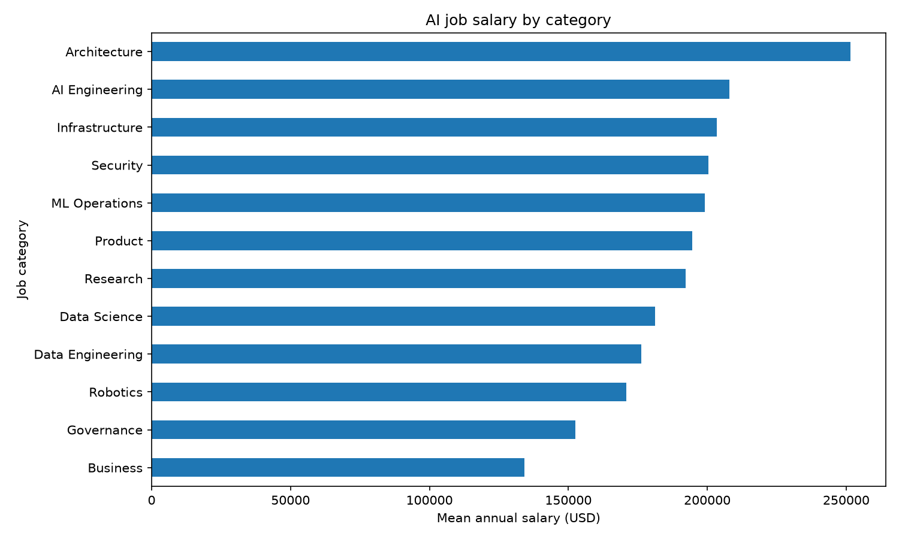

# Week 11 Mini-Assignment — Part 1: AI Jobs Airflow Pipeline

## Data and transformations

Source: `datasets/ai_jobs/ai_jobs_market_2025_2026.csv` (1,500 AI job postings from the student's earlier AI Jobs project). The source is copied into this repository so Docker can mount it at `/repo/datasets/ai_jobs/`. Its original external provenance was not supplied.

The one source file contains two related logical datasets:

| Table | Grain | Cleaning |
| --- | --- | --- |
| `ai_jobs.jobs` | One row per `job_id` | Trim text, convert numeric fields, remove duplicate IDs and rows with missing/invalid required values |
| `ai_jobs.job_skills` | One row per `(job_id, skill)` | Split `required_skills` on `|`, trim/lowercase, remove empty tokens and duplicate pairs |

The DAG merges skill counts and a Python-skill flag into `ai_jobs.jobs_enriched` (one row per job). The three business tables live in a separate `ai_jobs` schema of the existing PostgreSQL container. The load replaces their contents in one transaction, so a retry does not duplicate rows.

The raw file has no blank fields or duplicate job IDs. Some skill lists repeat a token within a job; the skill table removes those duplicates. Some `annual_salary_usd` values are outside the source's `salary_min_usd`/`salary_max_usd` range. This pipeline uses the annual salary as reported and does not treat those ranges as validation rules.

## Graph, scheduling, and analysis

```text
inspect_source ─┬─> clean_jobs ───┐
                └─> clean_skills ─┴─> merge_tables ─> load_postgres ─> analyze_from_database
```

The DAG ID is `ai_jobs_salary_pipeline`. It runs Mondays at 09:00 in Airflow's configured timezone (UTC by default), with `catchup=False`. Its two cleaning tasks are independent and can run in parallel under the configured `LocalExecutor`. `max_active_runs=1` prevents overlapping full-table loads.

The analysis task reads `ai_jobs.jobs_enriched` back from PostgreSQL, computes job counts and mean salary by category, and creates a bar chart. Per-run outputs are in `artifacts/airflow/ai_jobs/<run-key>/`: `jobs_clean.csv`, `skills_clean.csv`, `jobs_enriched.csv`, `salary_by_category.csv`, `salary_by_category.png`, and `analysis.json`. It also writes `datasets/ai_jobs/ai_jobs_clean_latest.csv` from the database as the Part 2 handoff.



## Run

From the repository root, start Docker Desktop and run:

```bash
docker compose -f infra/docker-compose.yml --env-file .env --profile airflow up --build -d airflow-db airflow-init airflow-scheduler airflow-webserver
docker compose -f infra/docker-compose.yml --env-file .env --profile airflow exec airflow-scheduler airflow dags unpause ai_jobs_salary_pipeline
docker compose -f infra/docker-compose.yml --env-file .env --profile airflow exec airflow-scheduler airflow dags trigger ai_jobs_salary_pipeline
docker compose -f infra/docker-compose.yml --env-file .env --profile airflow exec airflow-scheduler airflow dags list-runs -d ai_jobs_salary_pipeline
```

Airflow UI: <http://localhost:8088>. Open the DAG and its Graph and Grid tabs. The [Grid screenshot](images/ai_jobs_airflow_grid.png) shows two successful runs and all six tasks in green; the [Graph screenshot](images/ai_jobs_airflow_graph.png) shows the task dependencies. The default login is `admin` / `admin`, unless changed in `.env`.

Check the database and report:

```bash
docker compose -f infra/docker-compose.yml --env-file .env --profile airflow exec airflow-db psql -U airflow -d airflow -c 'SELECT COUNT(*) FROM ai_jobs.jobs_enriched;'
ls artifacts/airflow/ai_jobs/*/analysis.json
ls artifacts/airflow/ai_jobs/*/salary_by_category.png
```

The published CSV has target `annual_salary_usd`, suitable for a regression workflow in Part 2. It contains `job_id` for traceability; exclude it from model features. The category analysis is descriptive and does not establish a causal salary effect.

## Verified local run (November 5, 2026)

Two manual DAG runs completed successfully. After the second run, PostgreSQL still contained 1,500 jobs, 9,428 distinct job-skill links, and 1,500 enriched records, confirming that reruns do not duplicate data. The mean annual salary was $194,892. Architecture had the highest category mean at $251,576.92. These are descriptive results from the supplied CSV, not model evaluation metrics. The latest run report and chart were generated under `artifacts/airflow/ai_jobs/b826cc6a3481dd22/`.
