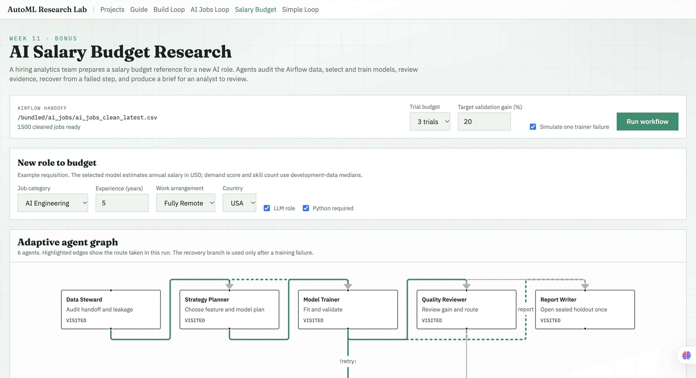
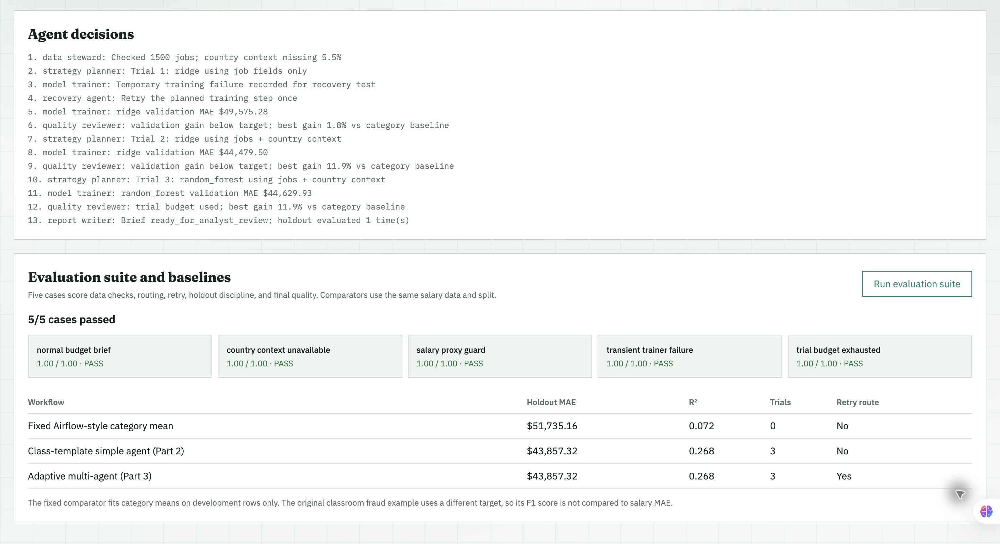

# Week 11 Bonus: Adaptive AI Salary Budget Research

## Scenario and data

A hiring analytics team needs a salary budget reference for a new AI role. The inputs are a role request and the 1,500-row table produced by the Part 1 Airflow DAG from [Kaggle AI job postings](https://www.kaggle.com/datasets/alitaqishah/ai-jobs-market-2025-2026-salaries) and [World Bank GDP per capita](https://data.worldbank.org/indicator/NY.GDP.PCAP.CD). The output is a model comparison and an analyst-facing brief with a role salary estimate, holdout error, baseline, assumptions, and limitations. It is not an automatic pay decision.

This bonus graph is implemented independently in `salary_budget_agents/graph.py`. It does not call the Part 2 graph to train or route its own trials. The Part 2 graph is used only as a comparator in the evaluation suite.

## Agent graph and decisions

```text
START -> Data Steward -> Strategy Planner -> Model Trainer
                                        Model Trainer -> Quality Reviewer (success)
                                        Model Trainer -> Recovery Agent (failure)
                                        Recovery Agent -> Model Trainer (one retry)
                                        Recovery Agent -> Report Writer (second failure)
                                        Quality Reviewer -> Strategy Planner (revise)
                                        Quality Reviewer -> Report Writer (goal or budget reached)
                                        Report Writer -> END
```

| Agent | Responsibility | Decision or output |
| --- | --- | --- |
| Data Steward | Validate cleaned rows, target, and requested role; flag excluded columns and country-data missingness | Country context is eligible when GDP missingness is at most 20% |
| Strategy Planner | Choose a model and feature set from reviewed history | Ridge with job fields, then Ridge with GDP when eligible, then Random Forest with GDP; without GDP, try job-only tree models |
| Model Trainer | Fit an imputation/encoding pipeline on training rows; measure validation MAE and R² | Return measured trial or a recoverable error |
| Quality Reviewer | Compare best validation MAE with a train-only category-mean baseline | Continue if gain is below target and trials remain; otherwise report |
| Recovery Agent | Handle a failed training step | Retry once, then stop the failed route |
| Report Writer | Refit the selected model on development rows, open the holdout, and estimate the requested role | Role salary reference, MAE, R², category baseline, assumptions, and a limitation statement |

The model uses only `years_of_experience`, `demand_score`, `is_llm_role`, `skill_count`, `has_python`, `job_category`, `remote_work`, and optionally `gdp_per_capita_usd`. IDs and salary-derived columns are excluded. The role form supplies category, experience, work arrangement, country, and LLM/Python requirements. Demand score and skill count are filled from development-set medians; GDP comes from the selected country's 2024 observation. All candidates share a fixed seed and a 60% training / 20% validation / 20% holdout split. The 20% holdout is not used for choosing a model. The default validation goal is a 20% MAE improvement over the category-mean comparator, with at most three trials. The failure toggle in the Dashboard injects one transient error for demonstration; no external service is required.



## Run locally

1. Run `ai_jobs_salary_pipeline` as described in the main README so `datasets/ai_jobs/ai_jobs_clean_latest.csv` exists.
2. Start the web app with `make start-mac` or `make start-windows` and open <http://127.0.0.1:5173/salary-budget>.
3. Fill in the new role form and click **Run workflow** to see the live route and brief. Optionally enable **Simulate one trainer failure** to observe the retry branch.
4. Click **Run evaluation suite**, or run the CLI command below from the repository root. The CLI writes `artifacts/salary_budget/evaluation.json`.

```bash
docker compose -f infra/docker-compose.yml --env-file .env exec gateway env PYTHONPATH=/:/app python -m salary_budget_agents.evaluate
```

## Evaluation suite

Each case is scored as the fraction of its checks that pass. Every case has a pass threshold of 1.00. The executable case definitions and detailed output are in `salary_budget_agents/evaluate.py` and `artifacts/salary_budget/evaluation.json`.

| Case | Input | Expected behavior | Scoring criteria |
| --- | --- | --- | --- |
| Normal budget brief | Cleaned 1,500-job handoff; default AI Engineering role; seed 42; three trials | Use eligible GDP data, select by validation MAE, beat category baseline, estimate role salary, open holdout once | Five checks, 0.20 each |
| Country context unavailable | Same data with GDP set missing; two trials | Route both trials to job-only features and still produce a brief | Four checks, 0.25 each |
| Salary proxy guard | Add `salary_tier` and `salary_min_usd` derived from target | Exclude both columns from model features and disclose exclusions | Three checks, one-third each |
| Transient trainer failure | Inject one training failure; one-trial budget | Visit Recovery Agent once, retry trainer once, finish with one holdout evaluation | Four checks, 0.25 each |
| Trial budget exhausted | Two trials; unattainable 99% validation gain target | Stop after two trials with budget reason, then evaluate holdout once | Three checks, one-third each |

Local result: **5/5 passed**. The suite measures intermediate quality (input checks, feature selection, measured validation winner), final quality (holdout MAE relative to baseline), and coordination (routes, retries, trial budget, holdout discipline).



## Comparison on the same salary task

| Workflow | Holdout MAE | Holdout R² | Trials | Retry path |
| --- | ---: | ---: | ---: | --- |
| Fixed Airflow-style category-mean comparator | $51,735.16 | 0.0718 | 0 | No |
| Class-template simple agent adapted in Part 2 | $43,857.32 | 0.2681 | 3 | No |
| Adaptive multi-agent bonus graph | $43,857.32 | 0.2681 | 3 | Yes |

The default AI Engineering example (five years of experience, fully remote in the USA, with LLM and Python requirements) received a $212,087.06 annual salary reference. The fixed comparator uses the salary-by-category idea from Part 1, with category means fitted on development rows only for a fair holdout score. It is an adapted fixed-step comparator, not the classroom fraud DAG's classifier. The simple-agent comparator is the Part 2 salary adaptation of the classroom loop. The original classroom fraud task uses classification F1 and cannot be compared numerically with salary MAE. The bonus workflow ties the simple agent on predictive error, while demonstrating feature-based routing and recovery. The low R² and dataset scope limit use of this brief for real compensation decisions.
